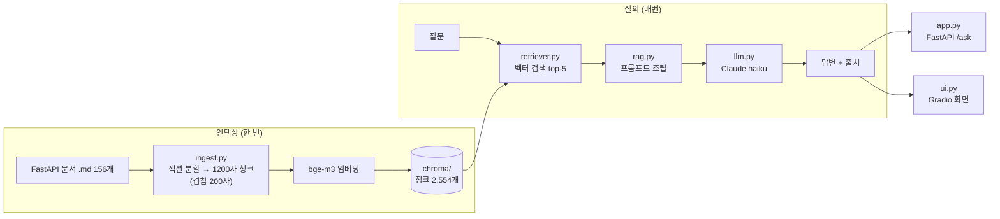

# FastAPI Docs Assistant

FastAPI 공식 문서(영문 마크다운 156개)를 근거로 한국어 질문에 답하고, 답변마다 출처 번호를 붙이는 RAG 시스템입니다.

## 무엇을 해결하나

FastAPI 문서는 양이 많고 영어로만 되어 있어서, 필요한 내용이 어느 페이지에 있는지 찾는 데 시간이 걸립니다. 이 시스템은 한국어 질문을 받으면 관련 문서 조각을 검색해 그 내용만으로 답합니다. 문장마다 `[1]`, `[2]` 같은 출처를 달고, 문서에 답이 없으면 지어내지 않고 "문서에서 찾을 수 없습니다"라고 답합니다.

## 결과 요약 (v0, 평가셋 100문항)

| 지표 | 값 | 뜻 |
|---|---|---|
| Recall@5 | **0.95** (76/80) | 검색 결과 상위 5개 안에 정답 문서가 들어 있는 비율 |
| MRR | 0.858 | 정답 문서가 평균적으로 몇 위에 나오는지 (1위면 1, 2위면 0.5) |
| 정답률 | **0.93** (74/80) | 답변 핵심이 정답과 같은 비율 (LLM 채점) |
| 충실도 | 0.88 (70/80) | 답변의 모든 주장이 검색된 문서에 근거한 비율 (LLM 채점) |
| 무응답 정확도 | 0.95 (19/20), 실제 20/20 | 답이 없는 질문에 "모른다"고 답한 비율 (아래 오류 분석 참고) |
| 질문당 비용 / 지연 | 약 $0.0003 / 2.6초 | claude-haiku-5-5 기준, 채점 비용 제외 |

## 아키텍처



- **입구가 둘**: `app.py`는 다른 프로그램이 부르는 API(`POST /ask`)이고, `ui.py`는 사람이 쓰는 화면입니다. 둘 다 같은 `rag.answer()`를 부릅니다.
- **검색 방식 교체 구조**: `answer()`는 검색 함수를 인자로 받습니다. 그래서 rag.py나 평가 코드를 고치지 않고 검색 방식만 바꿔 실험할 수 있습니다.

## 실험 기록

| 버전 | 청킹 | 검색 | Recall@5 | MRR | 충실도 | 정답률 | 무응답 정확도 | 지연 |
|------|------|------|---------:|----:|------:|------:|-------------:|-----:|
| v0 | 1200/200 | vector | 0.950 | 0.858 | 0.88 | 0.93 | 0.95 | 2.6s |

## 오류 분석 (v0)

결과 파일 `evals/results/v0-vector.jsonl`을 문항별로 확인했습니다.

**0. 병목은 검색보다 생성입니다.**

| 답이 있는 80문항 | 정답 | 오답 |
|---|---:|---:|
| 검색 성공 (정답 문서 top-5 안) | 72 | 4 |
| 검색 실패 | 2 | 2 |

정답 문서는 63문항(79%)에서 1위로 검색됐습니다. 검색 실패인데 정답인 2건은 다른 문서에도 답이 있던 경우로, 정답 문서 표기가 좁았던 탓입니다.

| 유형 | Recall | MRR | 정답률 | 충실도 |
|---|---|---|---|---|
| fact (40) | 38/40 | 0.846 | 37/40 | 37/40 |
| multi (20) | 19/20 | 0.887 | 18/20 | 18/20 |
| code (20) | 19/20 | 0.852 | 19/20 | **15/20** |

**1. 충실도 감점 10건 중 대부분은 지어낸 예시 코드입니다.**
감점된 답변은 대부분 핵심 내용은 맞았지만, 문서에 없는 코드 예시를 덧붙였습니다. FastAPI 문서는 예제 코드를 본문에 직접 쓰지 않고 `{* ../../docs_src/... *}` 같은 지시문으로 별도 파일을 불러옵니다. 그래서 청크에는 코드 대신 파일 경로만 남고, 모델이 그 빈자리를 자기 지식으로 채운 것으로 보입니다.
다만 지시문이 들어 있는 청크는 감점된 10건 모두에서 검색됐지만, 통과한 70건 중에서도 59건(84%)에서 검색됐습니다. 지시문이 너무 흔해서 이 숫자만으로는 원인이라고 단정할 수 없습니다.
→ v2에서 지시문을 실제 코드로 바꿔 넣고, 충실도가 오르는지로 가설을 검증합니다.

**2. 오답 6건 중 4건은 "찾을 수 없다"고 답한 경우입니다.**
그중 2건은 검색 단계에서 이미 정답 문서를 놓친 경우라 무응답이 오히려 옳은 동작이었습니다. 나머지 2건(`__call__` 질문, 201 + 응답 모델 질문)은 검색은 맞았는데도 답을 피했습니다. 시스템 프롬프트가 "문서에 없으면 무응답"을 강하게 요구해서, 정답이 여러 청크에 나뉘어 있거나 코드로만 나오는 경우 모델이 지나치게 몸을 사리는 것으로 보입니다. 나머지 오답 2건은 답은 했지만 정답의 핵심(lifespan, 모델의 examples)을 빠뜨린 경우입니다.

**3. 검색 실패 4건**
- "int 타입 경로 매개변수" 질문에 스트리밍 문서가 검색됐습니다. "변환/파싱"이라는 핵심어가 질문에 없어서 의미 검색이 엇나간 것으로 보입니다.
- 실패 사례 여러 건에서 `release-notes.md`가 상위에 올라옵니다. 변경 이력에는 모든 기능 이름이 한 번씩 나오기 때문입니다. → v2 후보: 변경 이력을 인덱스에서 빼거나 가중치 낮추기
- "Swagger UI 말고 다른 문서" 질문은 `features.md`도 답이 될 수 있어서, 정답 표기가 너무 좁았을 수 있습니다.

**4. 무응답 정확도의 실제 값은 20/20입니다.**
놓친 것으로 집계된 1건은 모델이 "문서에 답이 없습니다"라고 답한 경우입니다. 의미는 맞지만, 평가 코드가 정확한 문자열 "문서에서 찾을 수 없습니다"만 인정해서 틀린 것으로 셌습니다. 평가 코드의 판정 방식도 함께 점검해야 한다는 사례입니다.

**5. 유사도 임계값으로는 답 없는 질문을 거를 수 없습니다.**
1위 청크 유사도가 답이 있는 질문은 평균 0.655(최소 0.532), 답이 없는 질문은 평균 0.640(최대 0.691)입니다. 두 분포가 거의 겹칩니다. 임계값을 0.6으로 두면 답이 있는 질문은 11개가 잘리지만, 답이 없는 질문은 하나도 걸러지지 않습니다. 답 없는 질문을 "FastAPI와 비슷하지만 문서에 없는 주제"로 만들었기 때문입니다. 지금은 LLM이 문서를 읽고 판단하는 무응답 처리가 제 역할을 합니다(20/20).

**6. 검색 결과 5칸 중 절반 가까이가 낭비됩니다.**
`release-notes.md`가 100문항 중 39문항의 top-5에 들어갔습니다. 변경 이력에는 모든 기능 이름이 한 번씩 나오기 때문입니다. 같은 파일의 청크가 겹치는 경우도 많아서, top-5 중 평균 1.5칸이 중복입니다(47문항은 2칸 이상).

**7. 지연에 이상치가 있습니다.**
평균은 2.6초지만 한 문항은 20.9초가 걸렸습니다. 평균만으로는 이런 경우가 보이지 않으므로 p95도 함께 기록할 예정입니다.

## 평가 방법

**평가셋** `evals/qa.jsonl`, 100문항

| 유형 | 개수 | 목적 |
|---|---:|---|
| fact 단순 사실 | 40 | 기본 검색 성능 |
| multi 여러 문서 종합 | 20 | 문서 2개 이상을 엮어야 하는 질문 |
| code 함수명·코드 | 20 | 정확한 이름을 찾아야 하는 질문 |
| unanswerable 답 없음 | 20 | 문서에 없는 주제에 "모른다"고 답하는지 |

- 문항 초안은 LLM(Claude)이 원문 파일을 직접 읽고 작성했습니다. 문항마다 답이 적힌 원문 문장을 그대로 인용한 `evidence`를 붙였고, 정답 경로와 인용문이 실제 파일에 있는지 스크립트로 100% 대조했습니다.
- unanswerable 문항은 주제마다 문서 전체를 검색해 언급이 없는 것만 골랐습니다. GZip은 있지만 Brotli는 없는 경우처럼, 비슷하지만 없는 주제를 일부러 넣었습니다.
- 평가 대상 시스템(bge-m3 + haiku)은 출제에 쓰지 않았습니다. 시스템 자신이 만든 시험지로 채점하면 점수가 부풀려지기 때문입니다.

**지표**
- `python -m evals.eval_retrieval`: Recall@5, MRR. LLM을 쓰지 않아 무료입니다.
- `python -m evals.eval_answers --name v0-vector`: 충실도, 정답률, 무응답 정확도. 답이 있는 문항은 LLM 채점기(judge)가 판정하고, 답이 없는 문항은 무응답 문구 포함 여부로 판정합니다.

## 실행 방법

```powershell
py -3.12 -m venv .venv
.\.venv\Scripts\Activate.ps1
pip install -r requirements.txt
copy .env.example .env      # ANTHROPIC_API_KEY 입력
git clone --depth 1 https://github.com/fastapi/fastapi data/fastapi
python ingest.py            # 청킹 + 임베딩 → chroma/ (CPU에서는 오래 걸려 Colab GPU 권장)

uvicorn app:app --reload    # 터미널 1: http://127.0.0.1:8000/docs
python ui.py                # 터미널 2: http://127.0.0.1:7860
```

첫 질문은 임베딩 모델(bge-m3, 약 2.2GB)을 불러오느라 수십 초 걸립니다. 그다음 질문부터는 2~3초 안에 답합니다.

## 알려진 한계

- **평가셋이 쉬운 쪽으로 치우쳤을 수 있습니다.** 원문을 보며 만든 질문이라 원문 표현과 비슷합니다. 실제 사용자의 막연한 질문에서는 Recall이 더 낮을 수 있습니다.
- **평가셋 사람 검수가 아직 끝나지 않았습니다.** 검수표는 `evals/review.md`에 있습니다.
- **채점기를 아직 검증하지 않았습니다.** 답변 모델과 채점 모델이 같은 haiku라 자기 답에 관대할 수 있습니다. 20문항을 사람이 직접 채점해 judge와의 일치율을 잴 예정입니다.
- **문항 수가 적습니다.** 유형별 20~40문항이라 유형 안에서는 1문항이 2.5~5%p를 차지합니다. 몇 %p 차이는 개선이라고 단정하지 않습니다.

## 다음 실험 (v2)

한 번에 하나씩만 바꾸고, 바꿀 때마다 같은 100문항으로 다시 채점합니다.

- [ ] release-notes 제외 + 같은 파일 청크 중복 제거 → 검색 자료 낭비 줄이기
- [ ] 코드 지시문을 실제 예제 코드로 치환 → code 충실도 변화 (오류 분석 1번 가설 검증)
- [ ] 청크 크기 비교 (600 / 1200 / 2000)
- [ ] BM25 + 벡터 하이브리드 검색 (RRF) → Recall이 이미 높아 MRR 변화 위주로 확인
- [ ] 리랭커 적용
- [ ] 임계값 무응답 처리는 리랭커 점수로 재실험 (벡터 유사도로는 효과 없음, 오류 분석 5번)
